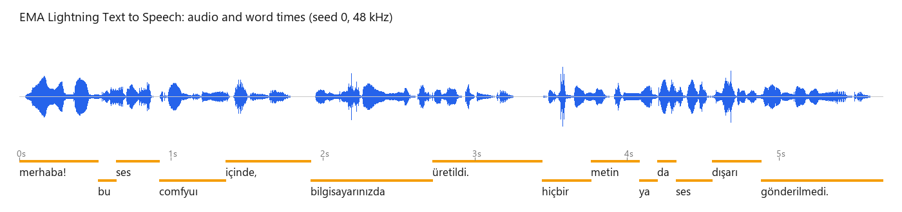

# EMA Lightning for ComfyUI

Turkish text to speech in ComfyUI with **EMA Lightning** ([canberkkkkkk/ema-lightning](https://huggingface.co/canberkkkkkk/ema-lightning),
code [canberk7/ema-lightning](https://github.com/canberk7/ema-lightning)): an 8.6M-parameter flow-matching model and vocoder (34 MB)
that speaks 48 kHz Turkish, reads numbers, dates, times and amounts aloud through a Turkish text normalizer, and reports when every
word is spoken. It runs **inside the ComfyUI process** through the official `ema-lightning` package, on the GPU or the CPU; the nodes
never download anything.

> **Unofficial.** This node pack is an independent integration. It is not affiliated with or endorsed by the EMA Lightning authors or
> by Comfy Org.
>
> 日本語の概要は [README.ja.md](README.ja.md) にあります。



*The shipped `tts_basic` workflow through the real ComfyUI queue: the saved audio and the word times the node returned.*

## What it does

| Node | Purpose |
| --- | --- |
| **EMA Lightning Loader** | Model folder from `models/ema_lightning`, device (GPU or CPU), the scheduler's batch size, and the optional compiled "lightning" mode |
| **EMA Lightning Text to Speech** | Text, seed, speed (0.25 to 4), sample rate (48 / 24 / 16 / 8 kHz) → `AUDIO`, the word times (JSON) and a report |

Connect the audio to ComfyUI's **Save Audio (Advanced)** (FLAC, MP3 or Opus) or **Preview Audio**. Two workflows are included:
`tts_basic` (FLAC) and `tts_announcement_mp3` (an announcement with a time and an amount, saved as MP3).

## How far it was checked

Windows 11, RTX 5090, ComfyUI v0.38.0, torch 2.14.1, ema-lightning 1.1.2 (details in [docs/VERIFICATION.md](docs/VERIFICATION.md)):

- **Bit-identical to the official package on the GPU.** The documented usage (`EMA(device).say(text, speed=..., seed=...,
  sample_rate=...)`) in a separate environment gives exactly the same waveform and word times as the node in 9 of 9 cases: short
  and long texts, numbers and dates, three seeds, speeds 0.75 / 1.0 / 1.5, 48 / 24 / 16 kHz, and batch sizes auto, 1 and 8.
- **On the CPU** the node equals the official package run under the same process conditions (9 of 9). Between processes, CPU
  results can differ by up to about 6e-7 (-124 dB) depending on what else the process imported (seen with ComfyUI's own model
  management loaded); the same holds for the official package alone.
- **Real ComfyUI queue:** both shipped workflows run; the saved 16-bit FLAC equals the official float audio rounded to 16 bits (largest
  difference half a 16-bit step).
- **Clean install:** fresh ComfyUI v0.38.0, fresh Python 3.12 environment, `git clone`, `pip install -r requirements.txt`, the model
  downloaded with `tools/download_model.py` (SHA-256 verified): both workflows give the same audio samples and word times as the
  development environment.
- **CI** (GitHub Actions; Ubuntu and Windows; Python 3.11 / torch 2.8.0 and Python 3.12 / torch 2.14.1): the tests and a real
  ComfyUI queue on the CPU with the real model.

**Not checked:** Linux or macOS with a GPU, AMD / Apple GPUs, the `lightning` mode with a working `torch.compile` (Triton), and speech
quality against the model card's benchmarks (the pack reproduces the official audio; it does not re-evaluate the model).

## Install

1. ComfyUI with the V3 node API (**v0.38.0** was used), Python 3.11+ (required by `ema-lightning` and `normalizer-tr`). Any
   NVIDIA GPU or just the CPU (the model is 34 MB).
2. Clone this repository into `ComfyUI/custom_nodes/` and install its requirement (the official package, which brings the Turkish
   normalizer):

   ```
   git clone https://github.com/hiroki-abe-58/ComfyUI-EMALightning custom_nodes/ComfyUI-EMALightning
   python -m pip install -r custom_nodes/ComfyUI-EMALightning/requirements.txt
   ```

3. Download the model (about 34 MB). The script pins the revision this pack was checked with and verifies every file's SHA-256:

   ```
   python custom_nodes/ComfyUI-EMALightning/tools/download_model.py --models-dir models/ema_lightning
   ```

   This creates `models/ema_lightning/ema-lightning/`. Another location works through `extra_model_paths.yaml` with the key
   `ema_lightning`.

4. Restart ComfyUI and open `workflows/gui/tts_basic.json`.

## Using the nodes

- **Text** is Turkish. Numbers, dates (15 Ekim 2026), times (14:30), amounts (1.250.000 TL) and symbols are read out by the
  package's normalizer; the word times list the words as spoken ("14:30" comes back as words). Text is lowercased with Turkish
  rules, so for example "ComfyUI" is listed as "comfyuı". Long texts are split into sentences.
- **Seed:** the same text, seed, settings and device give the same audio. CPU and GPU give different audio for the same seed.
- **batch_size** (Loader): how many sentences or audio windows the package's scheduler runs at once. `auto` is the package's own
  default: it measures the throughput once per device and caches the result in its cache folder (`~/.cache/ema_lightning`, or
  under `XDG_CACHE_HOME`). The audio can differ very slightly between batch sizes (largest seen: 9e-4) when a text needs more audio
  windows than the batch holds; a batch of 1 differs from all larger ones. The measured value is not stable: on the same RTX 5090
  one measurement gave 128 and another (fresh install) 8. For audio that repeats exactly across installs and machines, choose a
  fixed batch size.
- **lightning** (Loader, GPU only, off by default): the package's fast mode, recorded once per session. On this Windows machine
  `torch.compile` had no Triton, so the package recorded CUDA graphs without compiling: 190 graphs in 158 s, then a 7.9 s
  announcement in 12 ms. The audio differed from the plain path by up to 6.8e-4 (the package accepts up to 1e-2), so it is not
  bit-identical. The package also switches on cuDNN benchmark mode for the whole process when lightning starts, which affects other
  models in the same ComfyUI session.
- **Word times** (JSON: `text`, `start`, `end` in seconds) are useful for subtitles or lip-sync timing.
- The model stays loaded for the session (the package's scheduler thread keeps it alive; it is 34 MB).

## Measured on this setup

RTX 5090, batch size auto (128): a 7.9 s announcement in 0.036 s (about 220 times faster than real time); a short sentence in about
0.05 s after the first call. CPU (Intel Core Ultra 9 285K): a 5.7 s sentence through the whole ComfyUI queue in about 1 s.

## Licenses

- This node pack: **MIT** ([LICENSE](LICENSE)). It contains no third-party code.
- `ema-lightning` and `normalizer-tr` (installed packages) and the model (not included; downloaded only by
  `tools/download_model.py`): **Apache-2.0**. The model card adds that whoever deploys it is responsible for using it lawfully,
  including disclosure and consent rules for synthetic speech. See [NOTICE](NOTICE).

## Development

```
python -m pip install pytest ruff
python tools/download_model.py --models-dir refs/ema_lightning
EMA_COMFYUI_DIR=<ComfyUI checkout> EMA_MODEL_DIR=refs/ema_lightning/ema-lightning python -m pytest tests
python scripts/ci_queue_check.py --comfyui <ComfyUI checkout> --model refs/ema_lightning/ema-lightning
python scripts/run_parity.py --comfyui <ComfyUI checkout> --model refs/ema_lightning/ema-lightning --out pack.npz
```
